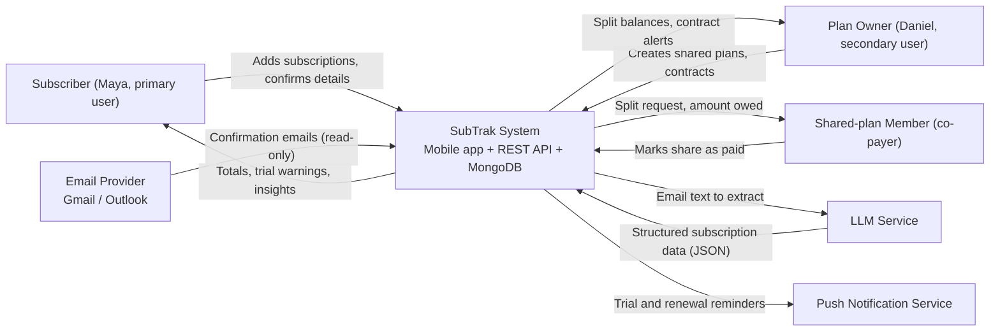
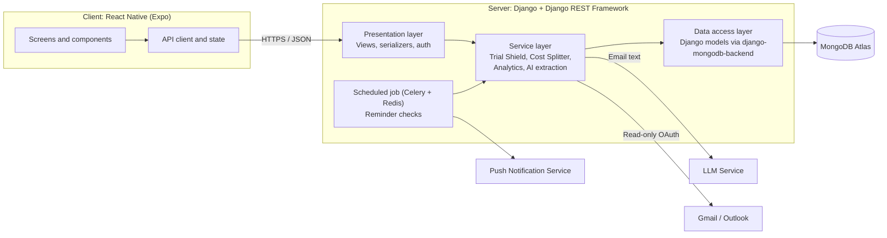

# SubTrak

A privacy-first mobile app for tracking recurring subscriptions. Users log their own charges — the
app never asks for bank or card credentials — and see what they spend, what renews next, and what a
plan costs once a trial converts.

Capstone project, CSC 325.

## Group Members

| Member | Role |
| --- | --- |
| Hassan Khan | Project Manager; Scrum Master (Sprint 0) |
| Christian Pivaral | Scrum Master (current); DevOps |
| Ankit Dhakal | Product Owner |
| Ahmed Rafi | DevOps |

> **Vertical slice owners — Pending.** Per-sprint vertical slice owners are not yet assigned.
> Record them here once the team agrees.

## Project Status

Sprint 0. Both halves of the stack are scaffolded and proven; no user story is finished yet.

| Area | State |
| --- | --- |
| Backend | Sprint 0 spike merged. MongoDB, custom user model, JWT wiring, `GET /health/` and `GET /me/`, plus DST-safe time zone helpers for US-5. 26 tests, 94% coverage, green in CI. No story endpoints yet. |
| Mobile | Phase 0 complete — scaffold, Figma design tokens (light + dark), the handoff-02 component library with a dev gallery, API layer, mock backend, session, navigation tree from handoff 03 (auth gate, four tabs + add button, modals, deep links) plus the AI-epic routes from handoff 11. 419 tests. Every screen is still a placeholder. |
| CI | `mobile-ci` and `backend-ci` both run on every push and pull request, both green on `main`. `verify` and `backend-verify` are required checks — see [Continuous Integration](#continuous-integration). |
| Docs | System design specification is done. Developer handoff specs `00`–`12` are in `docs/handoff/`. Team notes live in the `Capstone_CSC325/` Obsidian vault. |

## Repository Structure

```
.
├── backend/          # Django + DRF API (teammates own this)
│   ├── config/       # Django project settings, root URLconf, WSGI/ASGI entry points
│   ├── core/         # Health check, landing page and shared utilities
│   ├── accounts/     # Custom user model and /me
│   ├── subscriptions/  # Subscription model (spike-sized for now)
│   ├── mongo_migrations/  # Migrations for Django's contrib apps on MongoDB
│   ├── schema.yml    # Generated OpenAPI schema; CI fails if it is stale
│   ├── manage.py     # Django's command-line utility
│   ├── pyproject.toml  # ruff, pytest and coverage configuration
│   ├── requirements.txt / requirements-dev.txt
│   └── .env.example  # Template for local backend environment variables
├── mobile/           # React Native (Expo SDK 57) client
│   └── src/          # api/ components/ features/ navigation/ session/ theme/ test/
├── docs/design/      # System design specification, design notes, retired prototype PDF
├── docs/handoff/     # Developer handoff specs 00–12, one per task area
├── Capstone_CSC325/  # Obsidian vault: shared team notes (see Contributing)
├── docker-compose.yml  # Local MongoDB (single-node replica set); CI uses it too
├── .github/workflows # CI pipelines
├── CLAUDE.md         # Rules for AI coding sessions (Claude Code)
└── AGENTS.md         # Same rules for other AI agents; points to CLAUDE.md
```

## Documentation

| Document | Location |
| --- | --- |
| System Design Specification | [docs/design/SubTrak — System Design Specification.md](docs/design/SubTrak%20%E2%80%94%20System%20Design%20Specification.md) |
| Developer handoff specs (per task) | [docs/handoff/](docs/handoff/) — start at [00-README.md](docs/handoff/00-README.md); team assignments in [12-team-assignments.md](docs/handoff/12-team-assignments.md) |
| Visual design (source of truth) | Figma file `IKYivyJtmBYzJNQ7g8qPGc`, page "Full Integrated Prototype Epic A, B, C". Home is the exception: frame `4:2901` exists only in the original file `kyUS7F8bg4x7GpcPEF4UDN` |
| Earlier visual prototype (retired) | `docs/design/SubTrak prototype.pdf` |
| Colour contrast report | [mobile/src/theme/CONTRAST.md](mobile/src/theme/CONTRAST.md) |
| Design notes, page map and state critique | [docs/design/README.md](docs/design/README.md) |
| Mobile client conventions | [mobile/CLAUDE.md](mobile/CLAUDE.md) |
| Rules for AI coding sessions | [CLAUDE.md](CLAUDE.md), [AGENTS.md](AGENTS.md) |
| Team notes (Obsidian vault) | [Capstone_CSC325/SubTrak.md](Capstone_CSC325/SubTrak.md), then [Repo State](Capstone_CSC325/00%20-%20Project/Repo%20State.md) |

Where documents disagree, the handoff spec for the task wins, then Figma, then screenshots.
The specification is the source of truth for the data model (section 4), the API (section 5), auth
(section 6), CI (section 13) and the sprint mapping (section 14). Code comments cite it by section
number.

## Tech Stack

**Backend** — Python 3.12+, Django 6.1, Django REST Framework, MongoDB 7.0+ via
`django-mongodb-backend` 6.1, JWT auth with simplejwt, OpenAPI schema from drf-spectacular, pytest

**Mobile** — React Native via Expo, TypeScript (strict), React Navigation, TanStack Query

## Getting Started — Backend

### Prerequisites

- Python 3.12 or later (required by Django 6.1)
- pip
- Docker, for the local MongoDB. Without Docker, any MongoDB 7.0+ server works: install it
  yourself and point `MONGODB_URI` at it. A replica set is recommended (see `docker-compose.yml`).

### Setup

1. Clone the repository and move into it:

   ```bash
   git clone <repo-url>
   cd "Capstone Project"
   ```

2. Create and activate a virtual environment:

   ```bash
   python -m venv venv

   # Windows (PowerShell)
   venv\Scripts\Activate.ps1

   # Windows (Git Bash) / macOS / Linux
   source venv/Scripts/activate   # Git Bash on Windows
   source venv/bin/activate       # macOS / Linux
   ```

3. Start MongoDB from the repository root. `--wait` returns once the database accepts writes:

   ```bash
   docker compose up -d --wait
   ```

4. Install dependencies (`requirements-dev.txt` adds the test and lint tools):

   ```bash
   cd backend
   pip install -r requirements-dev.txt
   ```

5. Create your local environment file. The app will not start without `DJANGO_SECRET_KEY`:

   ```bash
   cp .env.example .env
   ```

6. Apply database migrations:

   ```bash
   python manage.py migrate
   ```

7. Create an admin account (optional, for `/admin`):

   ```bash
   python manage.py createsuperuser
   ```

8. Run the development server:

   ```bash
   python manage.py runserver
   ```

   Visit [http://127.0.0.1:8000/api/v1/health/](http://127.0.0.1:8000/api/v1/health/) to confirm it's
   running and connected to MongoDB. A healthy response is `{"status": "ok", "database": "ok"}`;
   if MongoDB is unreachable the endpoint answers 503 so the client can show a retry state.

All backend commands run from the `backend/` directory.

### Backend Environment Variables

Configured via `backend/.env` (see `backend/.env.example`):

| Variable               | Description                                         | Default                              |
|------------------------|-----------------------------------------------------|--------------------------------------|
| `DJANGO_SECRET_KEY`    | Signs sessions and JWTs                             | none — **required**, startup fails without it |
| `DJANGO_DEBUG`         | Enables Django debug mode; only the value `True` turns it on | `False`                     |
| `DJANGO_ALLOWED_HOSTS` | Comma-separated list of allowed hosts               | empty                                |
| `MONGODB_URI`          | MongoDB connection string; the path names the database | `mongodb://localhost:27017/subtrak` |

Never commit a real `.env` file or production secret key.

### Backend Commands

All run from `backend/`.

| Command                                   | Description                              |
|-------------------------------------------|------------------------------------------|
| `python manage.py runserver`              | Start the local development server       |
| `python manage.py migrate`                | Apply database migrations                |
| `python manage.py makemigrations`         | Create new migrations from model changes |
| `python manage.py createsuperuser`        | Create an admin user                     |
| `pytest`                                  | Run the test suite (needs MongoDB running) |
| `pytest --cov --cov-report=term-missing`  | Tests with a coverage report             |
| `ruff check .` / `ruff format .`          | Lint / format                            |
| `python manage.py spectacular --file schema.yml --validate` | Regenerate the OpenAPI schema; commit it with any API change |

> **Seed data — Pending.** The specification calls for a `manage.py seed_demo` command that builds a
> synthetic demo dataset. It has not been written yet.

### API surface

Everything under `/api/v1/` requires a JWT unless the table says otherwise. The generated contract
lives in `backend/schema.yml` and is also served at runtime.

| Endpoint | Auth | Description |
|----------|------|-------------|
| `GET /api/v1/health/`     | public | Liveness. Reports MongoDB; 503 when it is unreachable |
| `GET`/`PATCH /api/v1/me`  | JWT    | The signed-in user's profile |
| `GET /api/v1/schema/`     | public | OpenAPI 3.0 document for this server |
| `/admin/`                 | staff  | Django admin |
| `/`                       | public | Placeholder landing page |

### Backend status

Sprint 0's spike is merged. It moved the backend off SQLite onto MongoDB and proved the pieces the
specification depends on: the custom email-keyed user model, an embedded model with an
`EmbeddedFieldIndex`, DRF with simplejwt defaulting to `IsAuthenticated`, a committed OpenAPI
schema, and pytest against a real replica set. Time zone helpers with DST-safe local-to-UTC
conversion for US-5 followed (#71). The suite is 26 tests at 94.41% coverage, green in `backend-ci`.

Not built yet: registration, email verification, login, lockout and password reset (Epic A), the
subscription CRUD and dashboard endpoints (Epic C), Celery and Redis for reminders (Epic E), the
AI extraction subsystem (Epic D), and the `seed_demo` command. The `token_version` field exists on
the user but nothing reads it yet; the `tv` claim check in specification section 6 is a follow-up.

## Getting Started — Mobile

### Prerequisites

- Node.js 20 or later; CI runs 22
- The Expo Go app on a physical phone, or an Android emulator / iOS simulator

### Setup

```bash
cd mobile
npm install
```

### Running against mock data

The client ships a complete mock backend, so you can run every screen without the API. `mobile/.env.development`
sets `EXPO_PUBLIC_USE_MOCKS=true`, and Expo loads it automatically:

```bash
cd mobile
npm start
```

Scan the QR code with Expo Go, or press `a` for Android and `i` for iOS.

> Inline environment prefixes (`EXPO_PUBLIC_USE_MOCKS=true npm start`) do **not** work in PowerShell.
> Use the `.env` files, or `npm run start:mocks`, which handles the variable cross-platform.

### Running against the real backend

Point the client at a running API. On a physical device this must be your machine's LAN IP, not
`localhost`:

```bash
cd mobile
EXPO_PUBLIC_USE_MOCKS=false EXPO_PUBLIC_API_URL=http://192.168.1.50:8000/api/v1 npm start
```

Or copy `mobile/.env.example` to `mobile/.env.local` and set the values there.

### Mobile Commands

All run from `mobile/`.

| Command                 | Description                                           |
|-------------------------|-------------------------------------------------------|
| `npm start`             | Start the Expo dev server (mocks on)                  |
| `npm run start:mocks`   | Start with mock data forced on                        |
| `npm run start:api`     | Start against a real `EXPO_PUBLIC_API_URL`            |
| `npm run verify`        | Typecheck, lint, format check and tests — run before committing |
| `npm test`              | Jest                                                  |
| `npm run test:coverage` | Jest with a coverage report                           |
| `npm run typecheck`     | `tsc --noEmit`                                        |
| `npm run lint`          | ESLint                                                |
| `npm run format`        | Prettier write                                        |
| `npm run doctor`        | `expo-doctor` — dependency and config health          |

### Mobile status

Phase 0 is complete: the Expo scaffold, design tokens, 20 UI primitives with
tests, the API layer, the mock backend, session handling and the navigation
shell, including the AI-epic routes from handoff 11. **Every screen is still a
placeholder** — Epic A is Phase 1, Epic C is Phase 2, Epic B is Phase 3. See [mobile/CLAUDE.md](mobile/CLAUDE.md).

The tokens follow the Figma design: DM Serif Display and DM Sans, with light and
dark themes that follow the phone's setting. Components read colours through
`useTheme()`, so nothing is hardcoded to one theme. Every colour pair is checked
for WCAG AA contrast in both themes by `src/theme/tokens.test.ts`. The results
are in [mobile/src/theme/CONTRAST.md](mobile/src/theme/CONTRAST.md).

The shared components follow the developer handoff's component library: buttons,
fields (text, currency, date, select), the segmented control, toggles, settings
rows, list rows, bottom sheets, toasts, and empty/loading states. Every animation
switches off or cross-fades when the phone's Reduce Motion setting is on. In a
development build, **Settings → Component gallery** shows every component in
every state, with a light/dark switch.

There is no device or simulator on the development machine. What is verified is
`tsc`, ESLint, Prettier and Jest (419 tests, re-run 2026-10-20). Layout, font
scaling, the live light/dark switch and native modules are **not** verified. Run
the app in Expo Go on a phone to check those.

## Continuous Integration

Workflows live in `.github/workflows/`. Both run on every push to `main` and every pull request,
with no path filters: a required check that a path filter skips never reports, and the pull request
waits on it forever. Job ids become check names, so they are unique across the two workflows and
each can be made a required check.

| Workflow | Job | What it runs |
| --- | --- | --- |
| `mobile-ci.yml` | `verify` | ESLint, Prettier, `tsc --noEmit`, Jest with coverage |
| `backend-ci.yml` | `backend-verify` | ruff check and format, `makemigrations --check`, stale-schema check, pytest against the compose MongoDB with a 90% coverage floor |
| `backend-ci.yml` | `backend-audit` | `pip-audit` on `requirements.txt`, reporting only — `continue-on-error`, so an advisory in an unrelated package never blocks a pull request. Do not make it a required check. |

Both are green on `main`. The most recent backend run: ruff clean, no missing migrations, schema
current, 26 tests passed, 94.41% coverage, no known vulnerabilities (run on `9df066b`, 2026-10-20).

`backend-ci` brings up MongoDB from the repository's `docker-compose.yml` rather than a service
container, because the compose healthcheck is what initiates the replica set — so CI tests the same
database a teammate gets locally.

**Required checks.** The `main-protection` ruleset lists `verify` and `backend-verify` as
required status checks (checked 2026-10-20), so a pull request with a red CI run cannot merge.
`backend-audit` is deliberately not required.

### Keeping the OpenAPI schema current

`backend/schema.yml` is the generated contract the mobile client is built against. It is an OpenAPI
document, not a workflow, so it stays in `backend/` beside the code that generates it. Regenerate
and commit it with any API change:

```bash
cd backend
python manage.py spectacular --file schema.yml --validate
```

`backend-verify` enforces this: it regenerates the file and fails on `git diff --exit-code`, so a
stale schema cannot reach `main`.

## Screenshots

> **Pending.** Add screenshots of the Home, Subscriptions and Insights screens once the Epic C
> screens are built (Phase 2).

## Contributing

Branches are short-lived and named for the story, such as `feature/US-7-manual-entry`. Pull requests
stay under about 400 changed lines, link their issue, and carry a Definition of Done checklist plus
an AI-use note (tool, task, what you changed or verified) wherever AI wrote non-trivial code.

`main` is protected by the `main-protection` ruleset. What it enforces today:

- A pull request with **one approving review**. A push to the branch dismisses stale approvals.
- All review threads resolved before merge.
- **Squash merges only**, keeping history linear. Force-pushes and branch deletion are blocked.
- `verify` (mobile) and `backend-verify` must pass.

Run the checks locally before pushing — `npm run verify` in `mobile/`, and `ruff check . && pytest`
in `backend/` — rather than using CI as the first check.

### Team notes and AI sessions

The `Capstone_CSC325/` folder is an Obsidian vault of shared team notes. It is not authoritative:
the handoff specs, the specification, this README and `mobile/CLAUDE.md` outrank it, and a note that
disagrees with them gets fixed. [CLAUDE.md](CLAUDE.md) and [AGENTS.md](AGENTS.md) tell every AI
session the same rules:

- **Read first:** `SubTrak.md`, then `00 - Project/Repo State.md`.
- **Session logs are local-only.** Each session writes a log to `04 - Logs/`, named by date and
  branch (e.g. `2026-10-21 hassan-feature-x.md`). The folder is gitignored. Anything others need,
  such as a decision or an open follow-up, goes in a tracked note or the PR description. Decisions
  are recorded in `01 - Planning/Open Decisions.md`.
- **Repo State describes only `main`.** Nobody edits it on a feature branch. Whoever merges a pull
  request updates it right after, in a small follow-up pull request.

## Prototype

**Figma (public link):** https://www.figma.com/design/pVxnsuxlBW2yPOxwysbn6q/SubTrak---Prototype--CSC-325-?node-id=0-1&t=9ZthyuNMbt0qsZIs-1

The Figma file has four pages: `1 - Personas`, `2 - Context Diagram`, `3 - UI Screens` (clickable prototype, press Play starting at "1 - Connect Email"), and `4 - UX Flow`.

### Product Goal

> SubTrak helps people take control of recurring spending by automatically capturing subscriptions from confirmation emails (AI), warning them before free trials turn into paid charges, splitting shared costs, and surfacing renewal and contract dates in one simple mobile app.

Every persona, diagram, screen, and flow below is designed to serve this goal. Connecting an inbox is optional: users can always add subscriptions by hand, and SubTrak never asks for bank or card credentials.

### 1. Personas

| | **Maya Rodriguez (Primary)** | **Daniel Chen (Secondary)** |
|---|---|---|
| **Who** | 21, junior Marketing major, part-time barista, first-generation college student, iPhone | 34, operations analyst, lives with 2 roommates, Android |
| **Context** | About 9 subscriptions (Spotify, Netflix, Adobe CC, iCloud, Hulu trial...) on a tight budget | Organizes shared household plans (Netflix, YouTube TV, internet) and holds contracts (gym, software) |
| **Goals** | See what she pays each month; never get charged after a free trial; cancel unused subscriptions | Split costs fairly and see who paid; get warned before contracts auto-renew; see spending trends |
| **Frustrations** | Trial end dates buried in old emails; surprise charges; subscriptions scattered across email, app stores, and cards | Chasing roommates for money; silent auto-renewals; an out-of-date spreadsheet |
| **SubTrak features they need** | AI email extraction, Trial Shield, Dashboard, Analytics | Cost Splitter, Contract Alerts, Analytics |
| **How SubTrak's goal serves them** | Automatic capture and trial warnings stop the surprise charges she can't afford | Cost splitting and contract alerts replace his spreadsheet and keep shared plans in one place |

### 2. Context Diagram

The system sits in the center; arrows show data flow between SubTrak and its external actors.



The Figma version is on page `2 - Context Diagram`.

### 3. UI Screens (Figma page `3 - UI Screens`)

| # | Screen | Purpose (ties to Product Goal) |
|---|---|---|
| 1 | Connect Email | Onboarding; grants read-only inbox access so subscriptions are captured automatically |
| 2 | Dashboard | Monthly total, upcoming renewals, Trial Shield banner: all spending in one place |
| 3 | AI Review | Shows the subscription the AI extracted from an email, with confidence scores, before saving |
| 4 | Trial Shield | Lists free trials with days left and a cancel guide, so users avoid surprise charges |
| 5 | Cost Splitter | Shared plan split with paid / pending status and reminders; includes a contract alert |
| 6 | Insights | Spend by month and category plus an AI tip to cancel unused plans |

### 4. UX Flow (Figma page `4 - UX Flow`)

**Primary task (Maya):** track a free trial and cancel it before she is charged.

1. **Connect inbox** (Screen 1): Maya links Gmail with read-only access.
   - *Error path:* if the connection fails or she declines access, she skips this step and adds the trial manually.
2. **Review detected trial** (Screen 3): the AI extracts Hulu, $17.99/month, trial ends Oct 19; she confirms and a 3-day reminder is set.
   - *Error path:* if the AI can't read the email or returns low-confidence fields (highlighted on Screen 3), Maya corrects the service, price, or trial date by hand before saving. Nothing is saved until she confirms.
3. **Check dashboard** (Screen 2): she sees her $87.46 monthly total and the Trial Shield banner.
4. **Open Trial Shield** (Screen 4): Hulu has 2 days left.
5. **Decision:** cancel before the charge (cancel guide, trial marked cancelled, $17.99 avoided) or keep it (tracked as a paid plan).
6. **Review insights** (Screen 6): she checks spend by category and an AI tip.
7. *Optional branch:* **Cost Splitter** (Screen 5) to remind a roommate to pay a Netflix share.

**Secondary task (Daniel):** add a shared plan, invite roommates, auto-split the cost, track paid/pending, send reminders, and receive a contract alert 14 days before renewal.

The Figma page also includes a five-stage journey map (Onboard, Capture, Monitor, Act, Review) covering what the user does, what SubTrak does, and how the user feels.

---

## Architecture

SubTrak is a **client-server application** whose server follows a **layered architecture**. Client-server fits because the data (subscriptions, shared plans, reminders) must be shared between users and devices, and reminders and AI extraction have to run on a server even when the phone app is closed. Layering keeps business rules like trial dates and cost splits in one testable place, separate from HTTP and the database.



| Layer | Technology | Responsibility |
|---|---|---|
| **Client (presentation)** | React Native (Expo) | Renders the six screens, handles navigation and user input, calls the REST API over HTTPS |
| **API / presentation layer** | Django REST Framework (views, serializers, authentication) | Validates requests, authenticates users, shapes JSON responses; contains no business rules |
| **Service / business layer** | Plain Python modules | Business rules: trial-end and renewal calculation (Trial Shield), cost-split math (Cost Splitter), aggregation (Analytics), and the AI extraction pipeline (build prompt, call LLM, validate and normalize the result) |
| **Data access layer** | Django models + `django-mongodb-backend` | Persists users, subscriptions, shared plans, and reminders in MongoDB Atlas |
| **External services** | LLM API, Gmail/Outlook (OAuth), push notifications | Accessed only through the service layer so they can be mocked in tests and swapped later |

**Key design decisions**

- **Separation of concerns:** screens never talk to the database; views never contain business logic. This keeps services unit-testable without HTTP or a database.
- **AI isolation:** the LLM is called from one service module that returns validated, structured data with confidence scores. The user always reviews the result (Screen 3) before it is saved, so a wrong extraction cannot silently corrupt data.
- **Privacy:** email access is read-only and limited to receipts and confirmations; only the extracted fields are stored, not the full email.
- **Reminders:** a scheduled job finds trials and renewals due within 3 days (14 days for contracts) and sends push notifications.
- **Tooling:** GitHub Actions runs tests on every pull request (see Test Plan).

---

## Test Plan

Tests are grouped into four categories. Features covered: AI extraction, Dashboard totals, Trial Shield, Cost Splitter, Analytics, Contract Alerts.

### 1. Unit tests

Test one function or component in isolation, with no network or real database.

| ID | Target | Example test | Tool |
|---|---|---|---|
| U-1 | Trial Shield service | Trial ending Oct 19 returns "2 days left" on Oct 17 and is flagged at risk inside the 3-day window | pytest + pytest-django |
| U-2 | Cost Splitter service | $22.99 split 3 ways returns $7.66, $7.66, $7.67 (the extra cent goes to the plan owner) and the parts sum to $22.99 | pytest |
| U-3 | Monthly total | Annual and weekly plans are normalized to a monthly amount; cancelled plans are excluded | pytest |
| U-4 | AI response validator | Malformed or incomplete LLM JSON is rejected; valid JSON is normalized (dates, currency) | pytest with a mocked LLM client |
| U-5 | UI components | Trial card shows the correct chip color (red under 3 days, amber under 14, green otherwise) | Jest + React Native Testing Library |

### 2. Integration tests

Test that layers and components work together: API endpoints plus the real data layer (test MongoDB database), with external services mocked.

Tool: pytest with pytest-django and DRF's `APIClient`, against the docker-compose MongoDB; LLM and push services mocked.

| ID | Scenario | Expected result |
|---|---|---|
| I-1 | `POST /api/v1/subscriptions/` then `GET /api/v1/dashboard/` | Created subscription appears in the list and the monthly total updates |
| I-2 | `POST /api/v1/extract/` with a sample Hulu confirmation email (LLM mocked) | Returns structured fields; nothing is saved until the user confirms |
| I-3 | `POST /api/v1/shared-plans/` with 3 members, then mark one paid | Plan shows "2 of 3 paid" and the outstanding amount is correct |
| I-4 | Reminder job with trials ending in 2, 9, and 21 days | Only the 2-day trial triggers a push call (push service mocked) |
| I-5 | Requests without or with another user's auth token | Return 401 / 403; users can only see their own data |

### 3. System / end-to-end (UI) tests

Run the real app against a running test backend and walk through the primary user journey from the UX flow.

| ID | Journey | Expected result |
|---|---|---|
| E-1 | Connect email, confirm detected Hulu trial, return to Dashboard | Dashboard shows the new trial and the Trial Shield banner |
| E-2 | Open Trial Shield, choose "Cancel guide" | Trial is marked cancelled and no longer counts as at risk |
| E-3 | Create a shared plan, send a reminder to a pending member | Member status stays "Pending" and a reminder is recorded |

Tool: Maestro (or Detox with an Expo development build); run manually at each sprint review until automated.

### 4. AI feature evaluation and usability testing

- **AI extraction accuracy:** run the extractor on a labeled set of about 30 real-style confirmation emails (trial, monthly, annual, receipt). Record field-level accuracy for service, price, billing period, and trial end date. **Target: at least 90% on price and dates;** failures are reviewed to improve the prompt.
- **Usability:** ask 3 to 5 classmates matching the personas to complete the Maya task (track and cancel a trial) using the Figma prototype or the app. Measure task completion and note confusing steps.

### Execution and exit criteria

- Unit and integration tests run automatically in **GitHub Actions** on every pull request. `verify` and `backend-verify` are required checks (see [Continuous Integration](#continuous-integration)), so a PR cannot merge if they fail.
- Each user story's acceptance criteria are checked against the matching E2E or manual test before the story moves to Done on the Kanban board.
- **Exit criteria per sprint:** all tests pass, no open high-severity bugs, and the sprint demo flow (Maya's journey) works end to end.
